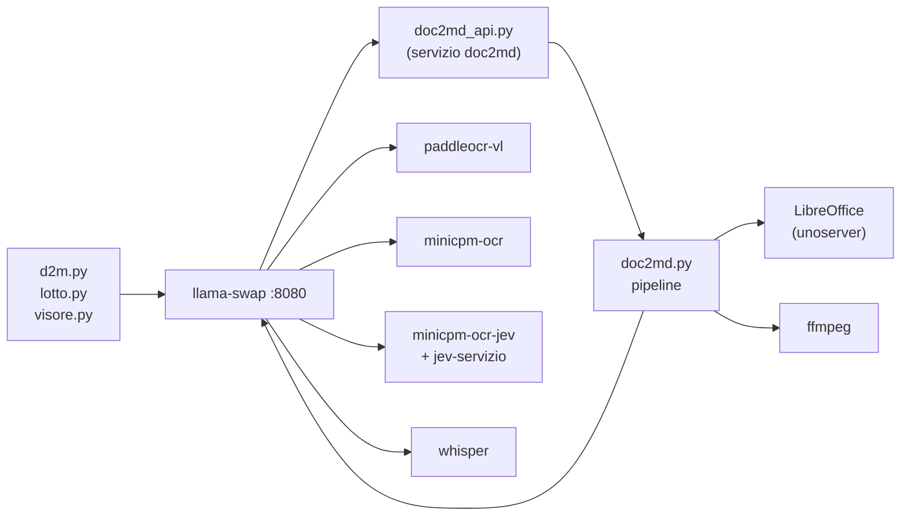

# doc2md

Converte documenti di ogni tipo in **Markdown** pronto per RAG, ricerca e LLM, **interamente in
locale**: tabelle, formule in LaTeX, schemi a blocchi e organigrammi in **Mermaid**, immagini,
trascrizioni di audio e video con i tempi. Ogni documento porta un identificativo (`doc_id`) che
permette di risalire all'originale.

Pensato per grandi quantità di documenti (un archivio di circa un milione di PDF) su un mini PC con
GPU integrata, usando modelli piccoli e caricandoli solo quando servono, tramite
[llama-swap](https://github.com/mostlygeek/llama-swap).

> *English summary: local-first document-to-Markdown converter (PDF, scans, Office, mail,
> archives, audio/video, web pages) with tables, LaTeX, Mermaid diagrams and image extraction;
> batch mode with SQLite exchange files, quality checks and a side-by-side web viewer.
> Documentation is in Italian.*

---

## Indice

1. [Cosa converte](#cosa-converte)
2. [Principi](#principi)
3. [Come funziona](#come-funziona)
4. [Installazione](#installazione)
5. [Configurazione: doc2md.ini](#configurazione-doc2mdini)
6. [Uso](#uso)
7. [Lotti: database e alberi di cartelle](#lotti-database-e-alberi-di-cartelle)
8. [Visore](#visore)
9. [Il Markdown prodotto](#il-markdown-prodotto)
10. [Controlli di qualità](#controlli-di-qualità)
11. [Prove di regressione](#prove-di-regressione)
12. [Limiti noti](#limiti-noti)
13. [File del progetto](#file-del-progetto)
14. [Licenze](#licenze)

---

## Cosa converte

Il tipo si riconosce **dal contenuto**, non dall'estensione (nei database il nome del file può
mancare o essere sbagliato).

| Ingresso | Come |
|---|---|
| **PDF nativo** (con testo) | testo, titoli ed elenchi da PyMuPDF; tabelle vere riconosciute dalla geometria; schemi vettoriali → Mermaid (`schema_geo.py`); formule lette dal modello; immagini contenute |
| **PDF scansionato, immagini** | la pagina si divide in regioni (PP-DocLayoutV3); testo con PaddleOCR-VL, tabelle e formule con MiniCPM-OCR, figure e schemi raster → Mermaid quando possibile (`schema_raster.py`) |
| **Word, PowerPoint** (docx, pptx) | letti dalla **struttura**: titoli, tabelle anche senza bordi, formule OMML → LaTeX esatto, dati dei grafici in tabella, SmartArt → Mermaid, note del relatore; un disegno fatto di frecce e connettori passa invece dal PDF per ricostruire lo schema |
| **doc, rtf, odt, ppt, odp** | LibreOffice li porta a docx/pptx, poi come sopra |
| **xls, ods, xlsx, csv** | celle esatte, un foglio per sezione |
| **eml, msg** | intestazione, testo e **ogni allegato convertito** (anche messaggi inoltrati) |
| **zip, tar, gz, bz2, xz, 7z** | ogni file contenuto convertito come sezione, anche archivi annidati (con limiti contro gli archivi "bomba") |
| **epub, html, ipynb, json, xml, svg** | testo strutturato; l'SVG come pagina vettoriale |
| **audio e video** | trascrizione locale con whisper.cpp, a blocchi di 10 minuti tagliati nelle pause, paragrafi con i tempi |
| **link** | pagine web (solo l'articolo, senza menu e pubblicità), documenti raggiungibili da un link, video di YouTube e degli altri siti supportati da yt-dlp; nelle cartelle, liste di link `.links` e scorciatoie `.url`, `.webloc`, `.desktop` |

## Principi

- **Niente esce dal computer.** Nessun servizio esterno: i modelli girano in locale. I documenti
  ricevuti non vengono mai inviati in rete e **non vengono scritti su disco**: dove un programma
  esterno richiede un file (LibreOffice, ffmpeg, yt-dlp, il divisore di pagina) si usa una cartella
  in RAM (`/dev/shm`), cancellata prima di restituire il risultato; le cartelle lasciate da un
  processo terminato a forza si cancellano al successivo avvio. Dalla rete si **legge** soltanto
  (pagine web, video da trascrivere).
- **Risorse solo quando servono.** llama-swap avvia modelli e servizi alla prima richiesta, li tiene
  pronti durante una raffica di richieste e libera la memoria dopo un periodo di inattività. Lo
  stesso vale per il servizio doc2md e per LibreOffice, che resta acceso solo finché lavora doc2md.
- **Il lavoro dei modelli è ridotto al minimo.** Le pagine native si leggono senza modelli; i modelli
  intervengono solo sulle regioni che ne hanno bisogno. Così si ottiene ~0,4 s per un referto
  nativo di una pagina.
- **Verifiche fatte dai programmi.** Ogni lotto misura da sé copertura e completezza del testo, e i
  casi dubbi si esaminano con strumenti dedicati.

## Come funziona



Per ogni pagina PDF:

1. **Pagina nativa o scansione?** Testo, lettere riconoscibili e area coperta da immagini decidono.
2. **Nativa:** blocchi di testo (con titoli ed elenchi, senza le intestazioni ripetute), tabelle
   vere, schemi vettoriali (riquadri **collegati** da frecce → Mermaid; riquadri senza collegamenti
   restano testo), formule (MiniCPM-OCR sulle sole aree di formula), immagini contenute.
   **Ordine di lettura** (dalla geometria, senza modelli):
   - la pagina si taglia dove uno spazio vuoto la attraversa tutta (XY-cut): le colonne di testo
     vere si leggono una dopo l'altra; righe, moduli e firme affiancate dall'alto in basso e da
     sinistra a destra;
   - due pezzi stanno sulla stessa riga se si sovrappongono in altezza per più di metà (font di
     dimensioni diverse hanno basi diverse); etichetta e valore separati tornano su una riga;
   - un blocco del PDF che unisce colonne diverse (due firme affiancate) si divide;
   - **riquadri di campi**: un riquadro disegnato che contiene campi separati, ciascuno nel suo
     rettangolo di ritaglio (generatori di report come i-net Clear Reports, Crystal Reports), diventa
     una tabella Markdown; etichetta e valore vicini stanno nella stessa cella.
3. **Scansione:** PP-DocLayoutV3 (ONNX, su CPU) divide la pagina in regioni; ogni regione va al
   lettore adatto (testo → PaddleOCR-VL, tabella e formula → MiniCPM-OCR); le figure passano da
   `schema_raster.py` (diagramma → Mermaid se la struttura è affidabile, altrimenti immagine).
4. **Facoltativo (`--jev`):** MiniCPM-OCR-Jev dà un voto 0-1 a ogni regione letta da un modello;
   le regioni con voto basso vengono segnalate.
5. **Composizione:** intestazione YAML, segni `<!-- DOCID:... -->` cercabili, immagini incorporate
   o separate (una per contenuto).

## Installazione

Provato su Ubuntu, mini PC Minisforum AI X1 Pro (AMD Ryzen AI, GPU integrata gfx1150 con
ROCm), 96 GB di RAM. Su altro hardware cambiano solo le build di llama.cpp e whisper.cpp.

### 1. Programmi esterni

| Programma | A cosa serve | Dove |
|---|---|---|
| llama.cpp (`llama-server`) | esegue i modelli visivi | [ggml-org/llama.cpp](https://github.com/ggml-org/llama.cpp); serve una build recente (b11928 o successiva) per MiniCPM-OCR-Jev |
| llama-swap | avvia e spegne modelli e servizi a richiesta | [mostlygeek/llama-swap](https://github.com/mostlygeek/llama-swap) |
| whisper.cpp (`whisper-server`) | trascrizioni | [ggml-org/whisper.cpp](https://github.com/ggml-org/whisper.cpp) |
| LibreOffice + unoserver | formati Office vecchi, anteprime | `sudo apt install libreoffice-core libreoffice-writer libreoffice-calc libreoffice-impress python3-uno`, poi `pip install --break-system-packages unoserver` nel Python di sistema |
| ffmpeg | audio e video | `sudo apt install ffmpeg` |
| Node.js o Deno | yt-dlp per YouTube | Node.js è sufficiente |
| MiniCPM-OCR (repository) | servizio render+score di Jev (solo per `--jev`) | [OpenBMB/MiniCPM-OCR](https://github.com/OpenBMB/MiniCPM-OCR), cartella `scripts/minicpm-ocr-jev` |

### 2. Modelli

| Modello | Ruolo | Dove |
|---|---|---|
| PP-DocLayoutV3 (ONNX) | divide la pagina in regioni | [phungpx/PP-DocLayoutV3-ONNX](https://huggingface.co/phungpx/PP-DocLayoutV3-ONNX): scarica tutta la cartella (contiene anche `pp_doclayout_v3_onnx.py` e `labels.json`) |
| PaddleOCR-VL 1.6 (GGUF) | testo | [PaddlePaddle/PaddleOCR-VL-1.6-GGUF](https://huggingface.co/PaddlePaddle/PaddleOCR-VL-1.6-GGUF) |
| MiniCPM-OCR 1.0 (GGUF) | tabelle e formule | `openbmb/MiniCPM-OCR-1.0-gguf`, vedi [OpenBMB/MiniCPM-OCR](https://github.com/OpenBMB/MiniCPM-OCR) |
| MiniCPM-OCR-Jev (GGUF) | voto delle trascrizioni (facoltativo) | `openbmb/MiniCPM-OCR-Jev-gguf`, vedi [OpenBMB/MiniCPM-OCR](https://github.com/OpenBMB/MiniCPM-OCR) |
| whisper large-v3-turbo q8_0 + Silero VAD | trascrizioni | script `models/download-ggml-model.sh` e `download-vad-model.sh` di whisper.cpp |

### 3. doc2md

```bash
git clone https://github.com/<utente>/doc2md ~/ai/tools/doc2md
cd ~/ai/tools/doc2md
python3 -m venv .venv && .venv/bin/pip install -r requirements.txt
cp doc2md.ini.esempio doc2md.ini          # e adatta cartelle e servizi
.venv/bin/python visore.py --scarica-librerie   # una volta: librerie del visore in locale
```

### 4. llama-swap

Aggiungi al `config.yaml` di llama-swap le voci di [`llama-swap-doc2md.yaml`](llama-swap-doc2md.yaml)
(modelli, servizio doc2md, servizio Jev, whisper), con i tuoi percorsi, e riavvia llama-swap.
Controllo:

```bash
.venv/bin/python doc2md.py --stato
```

Mostra la configurazione in uso e lo stato di ogni componente (modelli in llama-swap, divisore,
LibreOffice, ffmpeg, librerie, motore JavaScript per YouTube). Jev, il giudice facoltativo, si
controlla solo se è già acceso: `doc2md.py --stato --jev` lo accende e aspetta (la prima volta
anche un paio di minuti, perché carica il modello e il servizio di render).

## Configurazione: doc2md.ini

Un file di testo in formato INI, accanto al codice (oppure indicato dalla variabile `DOC2MD_INI`,
oppure in `~/.config/doc2md/doc2md.ini`). Senza file valgono i valori predefiniti di
[`doc2md.ini.esempio`](doc2md.ini.esempio), che descrive ogni voce.

```ini
[cartelle]
input  = ~/ai/data/doc2md/inp     ; documenti da convertire e file SQLite dei lotti
output = ~/ai/data/doc2md/out     ; Markdown prodotti

[servizi]
doc2md_url = http://127.0.0.1:8080/upstream/doc2md
llm_url    = http://127.0.0.1:8080/v1
```

Il visore esplora le stesse due cartelle. Ogni voce ha una variabile d'ambiente equivalente (per
esempio `DOC2MD_INPUT`, `DOC2MD_URL`) che **prevale** sul file: utile per prove o per impostazioni
diverse in un singolo comando.

**Link e rete interna.** Con `[rete] reti_private = no` (predefinito) un link si legge solo se il nome
porta a indirizzi pubblici: localhost, reti private (10/8, 172.16/12, 192.168/16, fc00::/7), link-local,
indirizzi riservati e multicast sono rifiutati, e il controllo si ripete a ogni redirect. Così il servizio
HTTP, se raggiungibile da altri, non diventa un modo per leggere i servizi interni. `reti_private = si`
(o `DOC2MD_RETI_PRIVATE=si`) toglie il controllo, per esempio per convertire pagine della intranet.

## Uso

### Un documento o un link: `d2m.py`

Client leggero (solo `requests`): manda il documento al servizio attraverso llama-swap, quindi si
può lanciare quante volte si vuole senza caricare nulla.

```bash
python d2m.py relazione.pdf                       # file di input: -> out/relazione.pdf.md e out/lotto.db
python d2m.py referti/2025/rx.pdf                 # -> out/referti/2025/rx.pdf.md e out/referti/lotto.db
python d2m.py *.pdf --jev --out-dir convertiti
python d2m.py riunione.m4a --lingua it --contesto "Marco Rossi, Assemblea condominiale"
python d2m.py "https://www.youtube.com/watch?v=..."
python d2m.py https://sito.it/articolo
```

Opzioni principali: `--immagini embedded|separate|none`, `--jev`, `--testate` (tiene intestazioni
e numeri di pagina), `--ocr` (legge con i modelli anche le pagine native), `--lingua`,
`--contesto` (nomi e termini da scrivere giusti nelle trascrizioni).

### Nello stesso processo: `doc2md.py`

Stesse opzioni, senza servizio (per prove e debug): `python doc2md.py documento.pdf -o documento.md`.

### API HTTP

`doc2md_api.py` (avviato da llama-swap come voce `doc2md`):

```bash
curl -F file=@fattura.pdf -F formato=json http://127.0.0.1:8080/upstream/doc2md/v1/converti
curl -F url=https://sito.it/articolo http://127.0.0.1:8080/upstream/doc2md/v1/converti
curl http://127.0.0.1:8080/upstream/doc2md/v1/stato
```

Campi: `file` oppure `url`, `immagini`, `jev`, `doc_id`, `testate`, `ocr`, `lingua`, `contesto`,
`segmenti`, `formato` (`md` oppure `json` con Markdown, rapporto e immagini separate in base64).
Con `segmenti=true` (audio e video, `formato=json`) il rapporto contiene `segmenti`: un elenco
`{"inizio": s, "fine": s, "testo": ..., "verifica": motivo}` con i tempi di ogni segmento di whisper
(`verifica` solo per i pezzi da riascoltare). Da riga di comando: `doc2md.py file.mp4 --segmenti`
scrive anche `file.segmenti.json`.

Dimensione massima del file: `[servizio] max_mb` (100) per i documenti, `max_mb_media` (2048) per audio e
video, riconosciuti dal contenuto. Gli upload oltre 1 MB che il server appoggia in un file temporaneo
vanno in `/dev/shm` (RAM), non sul disco. Di un video si usa solo l'audio: ffmpeg estrae subito la traccia
in WAV 16 kHz mono (`media.py`, `in_pcm`) e a whisper vanno solo blocchi di audio.

## Lotti: database e alberi di cartelle

`lotto.py` converte grandi quantità di documenti un documento alla volta, registrando ogni esito:
**Ctrl+C e rilancio ripartono da dove erano**.

### Da un database (file di scambio SQLite)

I documenti stanno come BLOB nel database d'origine e devono restare legati al loro record.

1. `python lotto.py crea lotto_001.db` crea il file di scambio (nella cartella `input`).
2. Riempi la tabella `documenti` (`chiave`, `nome`, `contenuto`, `meta`, `atteso`) dal database
   d'origine: con DBeaver, *Export results → Database*, guida passo passo in
   [`sql/lotto_sqlserver.sql`](sql/lotto_sqlserver.sql) (tabelle SQLite in
   [`sql/lotto_sqlite.sql`](sql/lotto_sqlite.sql)).
3. `python lotto.py db lotto_001.db` converte; i risultati tornano nello stesso file (tabelle
   `risultati` e `immagini`).
4. Reimporta `risultati` e `immagini` nel database d'origine (stesso file SQL).

Il `doc_id` nel Markdown è la **chiave del record in base64url**: reversibile
(`python lotto.py chiave <doc_id>`), con tutti i caratteri conservati.

### Da file e cartelle

```bash
python lotto.py cartella referti/2025      # una cartella con le sue sottocartelle
python lotto.py file referti/2025/rx.pdf   # un file solo (anche piu' file e cartelle insieme)
python d2m.py referti/2025/rx.pdf          # lo stesso, per i file della cartella input
```

Un percorso senza `/` iniziale si cerca anche nella cartella input. **L'uscita ricalca input** sotto
output, e ogni cartella di primo livello di input è un lotto con il suo `lotto.db` (stato,
risultati, controlli) e la sua `img/`; i file direttamente in input formano il lotto di output:

| Origine | Markdown | Lotto e immagini |
|---|---|---|
| `inp/referto.pdf` | `out/referto.pdf.md` | `out/lotto.db`, `out/img/` |
| `inp/referti/2025/rx_001.pdf` | `out/referti/2025/rx_001.pdf.md` | `out/referti/lotto.db`, `out/referti/img/` |

Ogni documento ha così un solo Markdown, sempre nello stesso posto, comunque sia stato convertito
(cartella intera, sottocartella, file solo, dal visore o dalla riga di comando). Nelle cartelle si
convertono i file mai fatti (`--riprova-errori` ritenta gli errori, `--rifai` tutti); un file
indicato da solo si riconverte sempre. Il `doc_id` è il percorso relativo a input in base64url
(`lotto.py chiave` lo riporta al percorso). I file `.db` (lotti) si saltano. Una cartella di primo
livello non può chiamarsi `img`. Fuori da input, o con `--out`, la cartella indicata è la radice
del lotto (`<output>/<nome>` o `--out`); `d2m.py` con `-o`, `--out-dir` o un file fuori da input
scrive solo il `.md`, senza lotto.

### Link nelle cartelle: `.links` e scorciatoie

Per far convertire pagine web e video insieme ai documenti, mettili in una cartella di input:

- **lista `.links`**: un link per riga; righe vuote e righe che iniziano con `#` si ignorano, i
  doppioni si tolgono. Dopo il link, separata da uno spazio, una descrizione facoltativa: per i
  video fa da contesto alla trascrizione (nomi di persone e luoghi scritti giusti).
  ```
  # fonti per i referti
  https://www.youtube.com/watch?v=myDEgFkHQnI  Assemblea condominiale, Marco Rossi
  https://www.example.org/articolo/notizia
  ```
  Ogni link diventa un documento del lotto: `inp/referti/fonti.links` →
  `out/referti/fonti.links/myDEgFkHQnI.md`, `out/referti/fonti.links/notizia.md` (stesso nome da siti
  diversi: si aggiunge un'impronta). Una lista si comporta come una cartella: a ogni conversione
  si scaricano solo i link nuovi (`--riprova-errori` ritenta quelli falliti, `--rifai` tutti).
- **scorciatoie** `.url` (Windows: trascina un link dal browser in una cartella), `.webloc` (macOS),
  `.desktop` (Linux, `Type=Link`): un link per file, come un documento normale
  (`inp/pagina.url` → `out/pagina.url.md`).

Il link resta nel lotto (colonna `url` di `documenti`), il `doc_id` di un link di una lista è
`<lista>#<link>` in base64url. Dalla rete si legge soltanto (vedi Principi). Un video lungo
richiede tempo: il limite per documento è `timeout` in `doc2md.ini` (predefinito 7200 s = 2 ore),
oppure `--timeout` sul singolo comando.

### Immagini: una per contenuto

Ogni immagine prende come nome l'impronta del contenuto (SHA-256, 32 caratteri esadecimali):
il logo ripetuto in 16.000 referti è **un solo file** (o una sola riga). Nel Markdown:
`[img-…]: img/<hash>.png`. I documenti che contengono un'immagine si trovano cercando l'hash nel
Markdown. Su SQL Server la tabella usa `IGNORE_DUP_KEY`, così le immagini già importate da un lotto
precedente vengono saltate.

### Comandi

| Comando | Cosa fa |
|---|---|
| `db FILE [--limite N] [--jev] [--riprova-errori] [--rifai]` | converte i documenti del file di scambio |
| `cartella PERCORSI... [--rifai] [--riprova-errori] [--out USCITA]` | converte cartelle (con le sottocartelle) e file nei loro lotti |
| `file PERCORSI...` | come `cartella`, per uno o più file (anche liste `.links`) |
| `stato FILE` | avanzamento, tempi, tipi, errori, verifica, completezza, immagini |
| `esamina FILE [chiavi] [--peggiori N] [--fasi]` | perché un documento ha copertura bassa: testo atteso, Markdown, contenuto del PDF, e con `--fasi` cosa prende ogni fase di doc2md |
| `verifica FILE` / `completezza FILE` | ricalcolano i controlli senza riconvertire |
| `esporta FILE` | elenco dei risultati in CSV (si apre con Excel) |
| `chiave DOC_ID` | dal `doc_id` di un Markdown alla chiave d'origine (per i file: il percorso relativo a input) |

## Visore

```bash
./visore.sh            # lo avvia in sottofondo e apre http://127.0.0.1:8095 nel browser predefinito
./visore.sh stop       # lo spegne
./visore.sh stato      # dice se è acceso
python visore.py       # in alternativa, in primo piano nel terminale (Ctrl+C per spegnerlo)
```

Una pagina web con **il documento originale a sinistra** (pagine del PDF, immagini, audio e video;
Word e simili convertiti in PDF solo per l'anteprima) e **il Markdown a destra**, con immagini,
formule (KaTeX) e schemi (Mermaid) disegnati, e i punti da ricontrollare evidenziati.

- **Cartelle:** si esplorano le cartelle `input` e `output` di `doc2md.ini`; un clic su un documento o su un
  `.md` apre la coppia (originale ↔ Markdown). Una lista `.links` mostra a sinistra i suoi link
  con l'esito (✅ convertito, ⏳ da fare, ❌ errore): un clic su un link apre il suo Markdown. Per i
  documenti letti da un link, a sinistra c'è il link: il visore non carica nulla dalla rete da
  solo, il link si apre con un clic in una nuova scheda.
- **Query SQLite:** un clic su un `.db` apre le query sul lotto, in **sola lettura** (solo `SELECT`),
  con query pronte (peggiori per verifica o completezza, errori, pagine OCR, schemi, formule…);
  un clic su una riga con la colonna `chiave` apre quel documento; `j` / `k` scorrono i risultati.
- **Conversione:** converte un documento solo, una cartella di documenti (con le sottocartelle) o
  un lotto `.db`, con `lotto.py` e con le regole di "Da file e cartelle"; pulsanti "converti il file aperto", "converti
  questa cartella" e "converti questo lotto". Stesse opzioni della riga di comando (ritenta errori, rifai tutti, Jev, OCR, limite, immagini, lingua). Mostra
  documenti fatti, errori e da fare, la barra di avanzamento con la fine stimata e il registro.
  **Ferma** finisce il documento in corso; **Ferma subito** interrompe anche quello (si rifà al
  prossimo avvio). Ripartire riprende da dove si era fermata. Una conversione alla volta: se
  `lotto.py` gira già da un terminale, il visore lo mostra e lo può fermare. Il registro sta in
  `<output>/<lotto>.log` (lotto `.db`) o in `lotto.log` accanto al `lotto.db` del lotto. Chiudere il visore
  ferma in ordine anche la conversione.

Ascolta solo su `127.0.0.1` e mostra solo file dentro le cartelle configurate; avvio e arresto
delle conversioni accettano solo richieste dalla pagina del visore. Da un altro PC:
`ssh -L 8095:127.0.0.1:8095 utente@mini-pc`, poi `http://127.0.0.1:8095`. Le librerie del browser
(marked, KaTeX, Mermaid) si scaricano una volta con `--scarica-librerie`; senza, la pagina le
prende da jsDelivr (si scaricano solo le librerie, nessun documento esce dal computer).

## Il Markdown prodotto

```markdown
---
doc_id: "MDAwMTIz"
fonte: "ARCHIVIO.DOCUMENTI.000123"
formato: pdf
pagine: 1
convertito: 2026-11-20T22:30:12+01:00
convertitore: doc2md 0.2
metodo: {nativa: 1}
immagini: separate
---

<!-- DOCID:MDAwMTIz -->
**doc_id:** `MDAwMTIz`

<!-- DOCID:MDAwMTIz p:1 metodo:nativa -->

## Radiodiagnostica
...
```

- `<!-- DOCID:... p:N metodo:... -->` all'inizio di ogni pagina: cercabile, invisibile quando il
  Markdown viene visualizzato.
- Tabelle in Markdown (HTML per le tabelle complesse con celle unite), formule tra `$...$` e
  `$$...$$`, schemi in blocchi ` ```mermaid `.
- `<!-- verifica: ... -->` segna i punti da ricontrollare: regioni con voto Jev basso, pezzi di
  trascrizione con punteggio basso o impossibilmente veloci (frasi inventate da whisper).
- Trascrizioni: paragrafi `**[mm:ss]** testo`, capitoli dei video come titoli; nell'intestazione
  titolo, canale, data, durata, lingua.

## Controlli di qualità

| Controllo | Misura | Dove |
|---|---|---|
| **verifica** | quota del testo atteso (colonna `atteso`, per esempio il testo del referto salvato a parte) ritrovata nel Markdown; i testi atteso segnaposto (meno di 15 parole) si escludono | `lotto.py stato`, colonne `verifica` e `mancanti` |
| **completezza** | quota del testo del PDF ritrovata nel Markdown (intestazioni ripetute e numeri di pagina esclusi) | `lotto.py stato`, colonne `completezza` e `mancanti_pdf` |
| **Jev** | voto 0-1 di MiniCPM-OCR-Jev sulle regioni lette dai modelli | `--jev`, intestazione `jev:` |
| **whisper** | pezzi di trascrizione dubbi | `whisper_da_verificare` nell'intestazione |

Risultati su un lotto reale di **16.492 referti** (PDF nativi di 1-2 pagine): 1,7 ore, nessun
errore; verifica media 99,9% sui 14.912 documenti con testo atteso valido; completezza ≥ 95% in
16.491 documenti su 16.492.

## Prove di regressione

In [`prove/`](prove/):

- `banco_schemi.py`: converte una raccolta di pagine con schemi già verificati e confronta i
  collegamenti trovati con il riferimento (verifica fatta una volta, poi solo programmi). Sulla
  raccolta usata per lo sviluppo: 377 collegamenti su 383 ritrovati.
- `raccogli_casi.py`, `valida_schemi.py`: preparano la raccolta e la pagina di verifica a vista.
- `ordine_lettura.py`: misura l'ordine di lettura delle pagine native su un lotto SQLite rispetto
  a pdftotext (documento intero e prime 80 parole in impaginazione, cioè intestazione e riquadri);
  con `--confronta doc2md.py.bak-...` confronta due versioni. Su 1000 referti del lotto reale
  (26/11/2026): ordine da 0,951 a 0,973, intestazione da 0,942 a 0,994, documenti sotto 0,95 da
  456 a 33, testo trovato e tempi invariati.
- `prova_contesto.py`: misura l'effetto del testo iniziale sulle trascrizioni di whisper
  (punteggiatura, nomi, frasi inventate).

I documenti di prova non fanno parte del repository: si usano i propri.

## Limiti noti

- Pagine web costruite interamente da JavaScript: il testo può risultare quasi vuoto (viene segnalato).
- Formule di documenti `.doc` molto vecchi (Equation Editor) dipendono da come LibreOffice le converte.
- Schemi raster complessi (corsie, molte linee incrociate) restano immagini.
- Le trascrizioni ereditano i limiti di whisper (nomi propri: aiutano `--contesto` e il titolo dei video).

## File del progetto

| File | Contenuto |
|---|---|
| `doc2md.py` | pipeline e riga di comando |
| `doc2md_api.py` | servizio HTTP (avviato da llama-swap) |
| `d2m.py` | client leggero |
| `lotto.py` | conversione a lotti, controlli, esame dei casi |
| `visore.py`, `static/visore.html` | visore web |
| `visore.sh` | avvio del visore in sottofondo e apertura del browser |
| `formati.py` | Word, PowerPoint, archivi, posta, epub, html, notebook |
| `media.py` | audio, video, YouTube |
| `web.py` | pagine web e documenti da link |
| `schema_geo.py` | schemi vettoriali → Mermaid |
| `schema_raster.py` | schemi nelle immagini → Mermaid |
| `modelli.py` | chiamate ai modelli, divisore di pagina, Jev |
| `config.py`, `doc2md.ini.esempio` | configurazione |
| `llama-swap-doc2md.yaml` | voci per llama-swap |
| `sql/` | file di scambio SQLite e guida per SQL Server / DBeaver |
| `prove/` | prove di regressione |

## Licenze

doc2md è distribuito con licenza **GNU AGPL-3.0** (file [`LICENSE`](LICENSE)), perché usa
[PyMuPDF](https://github.com/pymupdf/PyMuPDF), distribuito con licenza AGPL-3.0 (oppure con
licenza commerciale Artifex), ed [extract-msg](https://github.com/TeamMsgExtractor/msg-extractor)
(GPL). Le altre librerie Python hanno licenze permissive: MarkItDown (MIT), trafilatura
(Apache-2.0), yt-dlp (Unlicense), FastAPI (MIT), uvicorn (BSD), OpenCV (Apache-2.0), ONNX
Runtime (MIT), Pillow (MIT-CMU), openpyxl (MIT), python-pptx (MIT), requests (Apache-2.0),
unoserver (MIT); nel browser marked, KaTeX e Mermaid (MIT).

Il repository **non include** programmi né modelli esterni: ciascuno mantiene la propria licenza
(vedi le relative pagine), da verificare prima di un uso commerciale.

## Uso nel serverMCP (Mini PC)

- Voce llama-swap **`doc2md`** (gruppo `ausiliari`): `.venv/bin/python -m uvicorn doc2md_api:app --app-dir ~/ai/tools/doc2md`,
  `checkEndpoint: /health`, `ttl: 300`, `unlisted: true`. Configurazione in `doc2md.ini`.
- Voce `doc2md` di `~/ai/serverMCP/tools.yaml` (`timeout_s: 7200`, seriale), profili agenti ed esterni.
  Modulo `~/ai/serverMCP/tools/doc2md.py`: **`doc2md_converti(contenuto_base64+nome | percorso, immagini="none",
  ocr, jev, testate, lingua, contesto, rapporto=false)`** → `doc_id`, `markdown`, `riepilogo` (o `rapporto` completo).
  Il file va al servizio come contenuto multipart (formato sempre `json`), mai come percorso. Con
  `immagini="separate"` le figure (max 20) tornano come contenuti immagine MCP. `url` solo per il profilo agenti:
  il serverMCP rifiuta i nomi che risolvono a indirizzi non pubblici e doc2md ripete il controllo a ogni
  redirect (`[rete] reti_private = no`). Prove del 25/11/2026: `https://example.com/` e redirect pubblico OK;
  127.0.0.1, localhost, ::1, ::ffff:127.0.0.1, 10.x, 192.168.x, 169.254.169.254, `file://` rifiutati; redirect
  verso 127.0.0.1 rifiutato (prova in-process con un server locale); `url` dal profilo esterni rifiutato.
- Prova con i campioni di `~/ai/data/test`:

      curl -s http://127.0.0.1:8080/upstream/doc2md/v1/converti -F file=@/home/frank/ai/data/test/testo-tabella.pdf
      curl -s http://127.0.0.1:8080/upstream/doc2md/v1/converti -F file=@/home/frank/ai/data/test/jfk.wav -F lingua=en

  Esito del 25/11/2026 (`testo-tabella.pdf`, a freddo): Markdown con titoli, elenchi e tabella 3×3 corretti, 2,1 s.
  Via serverMCP (25/11/2026): `testo-tabella.pdf` 0,2 s; `formula.pdf` 18,1 s (nativa+formule); `testo-tabella.png`
  10,8 s (OCR); `jfk.wav` 1,9 s (trascrizione corretta); PDF con una foto, `immagini=separate`, profilo esterni in
  base64: 1,6 s, 1 immagine restituita. Audio mp3 (da `jfk.wav` con ffmpeg: mono 64 kbit/s, stereo 44,1 kHz VBR
  con tag ID3, nome `.bin`): trascrizione corretta in tutti i casi.
  Video lungo (mp4 di 43:37, 245 MB, prima rifiutato per il limite di 100 MB): con `max_mb_media = 2048`
  via `d2m.py` 120,5 s e via serverMCP (percorso, invio in streaming) 118,3 s; picco di memoria del servizio
  0,5 GB, del serverMCP 59 MB, `/dev/shm` 286 MB durante l'upload; whisper resta acceso per tutto il lavoro;
  144 paragrafi, `whisper_da_verificare: 93` (segmenti di whisper con `avg_logprob` < -0,25 o più di 25
  caratteri/s: parlato sovrapposto, musica ed effetti di un film).
